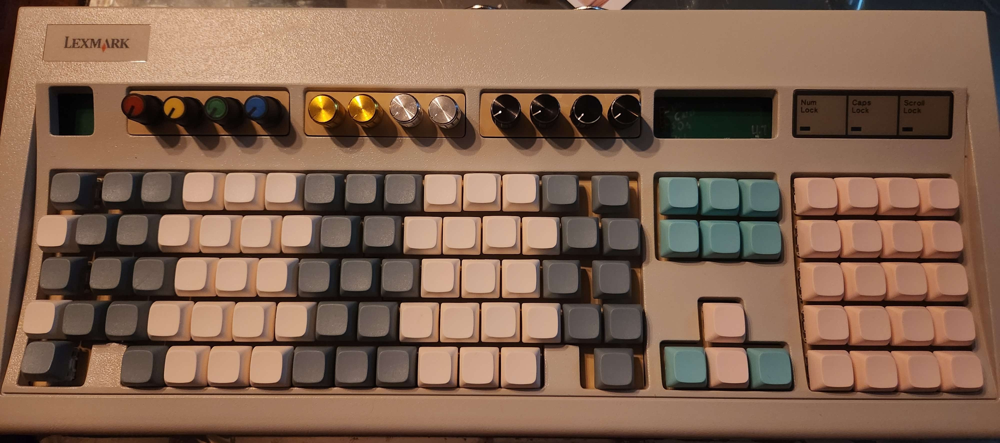

# keyboard-keyboard

A hall-effect MIDI keyboard controller built around the Electrosmith Daisy Seed (STM32H750V). The layout follows the IBM Model M form factor but is tuned to work as a Wicki-Hayden isomorphic musical keyboard. Keys 81–100 are drum pads on MIDI channel 10.



## Hardware

- **MCU:** Electrosmith Daisy Seed Rev4 (STM32H750V)
- **Sensors:** 100x MT9105ET hall-effect sensors across 13 SN74LV4051A analog muxes (AM1–AM13)
- **Pots:** 12 trim potentiometers on AM14–AM15, read as MIDI CC
- **Display:** 128x32 SSD1306 OLED over I2C
- **MIDI:** USART1 at 31250 baud (DIN-5 out, opto-isolated in via 6N138)

The firmware drives 100 switches across 13 muxes plus 12 pots on AM14–AM15.
Existing boards need the revision-specific checks in [Known Issues](#known-issues).

Full pin mapping and mux architecture: [`keyboard_keyboard/code/HARDWARE.md`](keyboard_keyboard/code/HARDWARE.md)

KiCad schematic: `keyboard_keyboard/kicad/keyboard_keyboard.kicad_sch`

## Firmware

Firmware is in `keyboard_keyboard/code/`, written in Rust using [RTIC](https://rtic.rs/) for the real-time task scheduler.

### Setup

```sh
rustup target add thumbv7em-none-eabihf
rustup component add llvm-tools-preview
cargo install cargo-binutils
# probe-rs / cargo-embed: https://probe.rs/docs/getting-started/installation/
```

### Build and flash

Run these from `keyboard_keyboard/code/`:

```sh
cargo check        # type-check without a connected device
cargo build        # compile for thumbv7em-none-eabihf
cargo embed        # flash to Daisy Seed (reads Embed.toml)
```

RTT logs stream automatically during `cargo embed`. Set `DIAG_LOGGING = true` in `src/main.rs` for verbose per-switch ADC and baseline output.

GDB attach (in a separate terminal after `cargo embed`):

```sh
arm-none-eabi-gdb target/thumbv7em-none-eabihf/debug/app
# in gdb:
target remote :1337
```

### How it works

The `timer_handler` task fires at 1 kHz, scans all 13 muxes × 8 channels, and runs a three-state machine (`Idle → FirstActuated → FullyActuated`) per switch. Velocity is derived from the time between two ADC thresholds within an 80 ms window. Pot values are scanned every 10 ms and sent as CC messages. MIDI events queue into a `heapless::spsc::Queue` and are sent by a lower-priority `process_events` task.

Boot calibration averages 64 ADC samples per switch to establish per-key baselines before the timer starts.

## Known Issues

**Older fabricated boards:** U1 pins 7/Y7 and 9/Y6 were incorrectly grounded.
The current schematic leaves them explicitly unconnected; the PCB isolates them
from the ground pour and directly connects enable pins 4/5 to ground. The copper
zones are refilled to clear the pot ADC trace. A source-file update does not
repair an existing PCB: inspect the built revision before applying rework.

**Current pin mapping:** U1 pins 4/5 are low, pin 6 is high. Pot ADC input is
Daisy pad 35 (D28/A11); pad 33 is unconnected. Earlier instructions claiming that
the current design needs a pin-5 bridge or pad-33 bodge are obsolete.

**Power and temperature:** 100 Hall sensors are a substantial continuous load.
The hot-room incident still needs rail/current/temperature measurements. A
regulator upgrade has not been validated. See the [hardware reference](keyboard_keyboard/code/HARDWARE.md).

**Firmware timing:** MIDI transmission runs outside the priority-15 event-queue
lock. Full-scan event storage prevents the old 32-key burst limit; queue overload
is logged and sends all-channel All Notes Off to recover lost releases. Actual
firmware verification commands are in [seed-tests](tools/seed-tests/README.md).

## Acknowledgements

- Hall-effect keyboard layout based on [peppapighs/HE60](https://github.com/peppapighs/HE60/tree/main)
- Model M physical layout based on [dcpedit/mod-mmm](https://github.com/dcpedit/mod-mmm)
